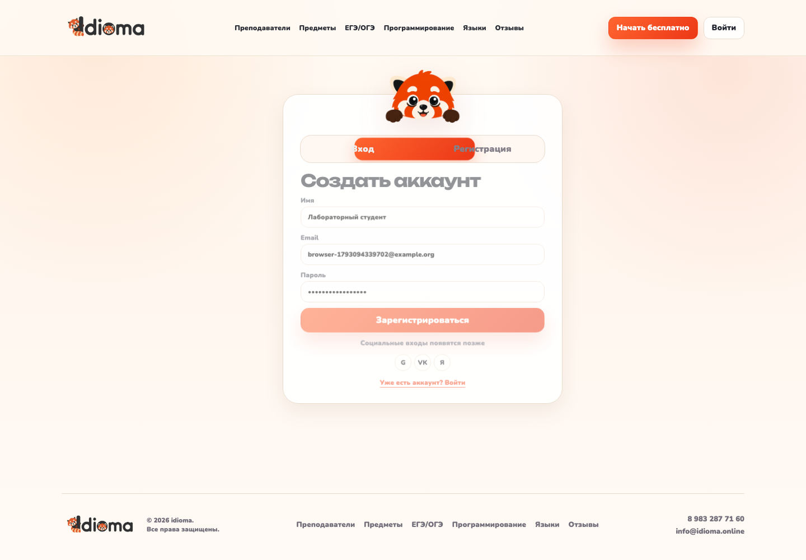
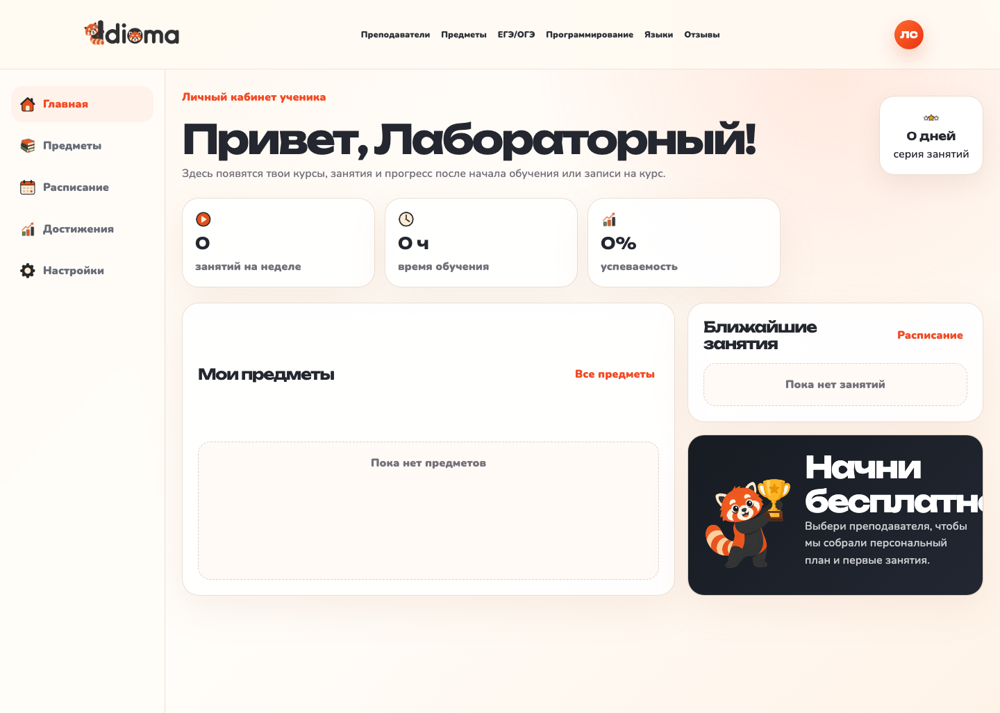

# Лабораторная 0 Свой сервис

## Цель и приложение

Для лабораторных используется idioma — платформа онлайн-школы.
Исходники взяты из собственного проекта `Programming/idioma`.
Копия находится в `app/src`; персональные данные, `.env`, Telegram-сессии и
готовая база не переносились. Полный перечень скопированных файлов с SHA-256
сохранён в [source-manifest.json](source-manifest.json).

Приложение состоит из трёх частей:

| Часть | Реализация | Общение |
|---|---|---|
| Фронтенд | React 19, Vite, статика через nginx | HTTP `/api/*` к бэкенду |
| Бэкенд | Python 3.12, FastAPI, SQLAlchemy | TCP `db:5432` к PostgreSQL |
| База | PostgreSQL 16, отдельный контейнер | Именованный том `pgdata` |

Регистрация `POST /api/auth/register` записывает пользователя в таблицу `users`.
`GET /api/auth/me` читает пользователя по сохранённому токену.
`GET /api/subjects` возвращает каталог из базы, который показывает React.
Пароль пользователя хранится как хеш. Telegram отключён в окружении стенда.
Для учебной проверки показана уже реализованная форма регистрации: из копии CSS
убраны правила, скрывавшие переключатель регистрации на публичном сайте.
Добавлены `X-Instance-ID` и `/api/readiness`: второй проверяет не только процесс,
но и `SELECT 1` в базе. Эти проверки пригодятся в следующих лабораторных.

## Запуск

```bash
docker compose up -d --build --wait
docker compose ps
python3 check.py
```

Открыть [http://localhost:8080](http://localhost:8080), перейти на страницу входа,
выбрать «Регистрация», заполнить имя, уникальный email и пароль. После регистрации
обновить страницу. Аккаунт остаётся доступен; после выхода можно снова войти с теми
же данными. API отдельно доступен на `http://localhost:18000/api`.

Проверить запись непосредственно в PostgreSQL:

```bash
docker compose exec -T db psql -U idioma -d idioma -c   'SELECT id, email, full_name, role FROM users ORDER BY id DESC LIMIT 5;'
```

`check.py` регистрирует уникального студента, читает его новым HTTP-запросом,
выполняет повторный вход и проверяет каталог и HTML фронтенда. Скрипт не подменяет
базу моками и не использует SQLite. Вывод — [evidence/check.txt](evidence/check.txt).

## Остановка

```bash
docker compose down
```

Том сохраняется. `docker compose down -v` удалит учебную базу — применять только
для намеренного полного сброса стенда.

## Результаты

Фактический запуск, состояние контейнеров и запросы к БД сохранены в `evidence`.
Скриншот работающего интерфейса: [frontend.png](evidence/frontend.png).

Проверка через настоящий браузер: [browser-check.txt](evidence/browser-check.txt).





Скрипт [browser-check.mjs](browser-check.mjs) воспроизводит этот сценарий с
Playwright: заполнение формы, HTTP 201 и получение того же пользователя через
`GET /api/auth/me` после полной перезагрузки `/dashboard`.
