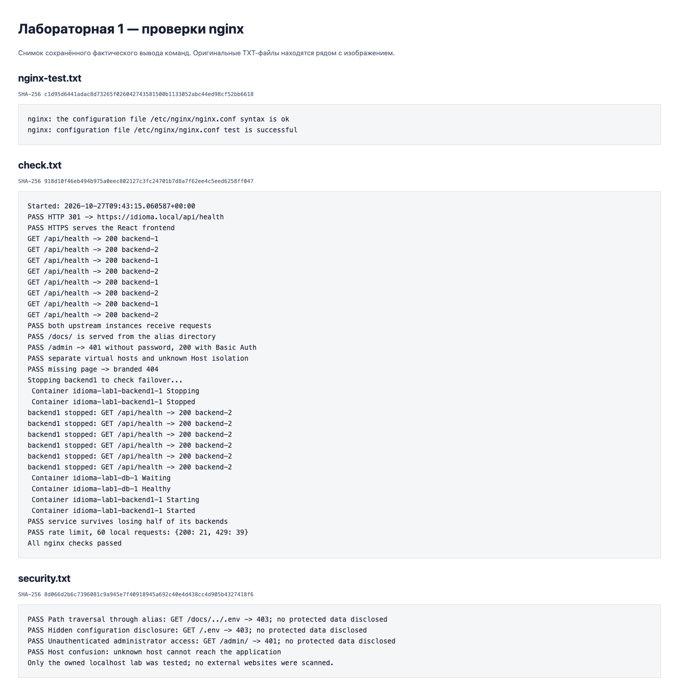

# Лабораторная 1 nginx

## Цель и устройство

nginx служит единственной точкой входа по HTTP/HTTPS. Он самостоятельно отдаёт
сборку React из лабы 0 и направляет `/api/` на два экземпляра FastAPI с общей
PostgreSQL. Прямые учебные порты бэкендов на хосте — `18001` и `18002`. Имена `backend-1` и `backend-2` видны в заголовке `X-Instance-ID`.
Контейнер nginx не подключён к сети базы.

## Запуск

Сначала собрать образы лабы 0, если они ещё не собраны:

```bash
docker compose -f ../lab0/compose.yaml build
bash prepare.sh
docker compose up -d --build --wait
docker compose exec -T nginx nginx -t
bash check.sh 2>&1 | tee evidence/check.txt
```

Открыть [https://localhost](https://localhost). Сертификат самоподписанный,
поэтому браузер запросит разрешение на переход. Сгенерированные ключ и парольный
файл исключены из Git. `prepare.sh` создаёт их локально.

Для второго виртуального хоста без изменения `/etc/hosts`:

```bash
curl -k --resolve idioma.local:443:127.0.0.1 https://idioma.local/api/health
curl -k --resolve second.local:443:127.0.0.1 https://second.local/
```

## Настройка

Полная конфигурация: [nginx/nginx.conf](nginx/nginx.conf).

| Требование | Реализация | Проверка |
|---|---|---|
| HTTPS и редирект | TLS 1.2/1.3, HTTP `return 301` | `/api/health` по HTTP возвращает Location на HTTPS |
| Статика и API | `root` со сборкой React, `proxy_pass` для `/api/` | HTML и JSON через один адрес |
| Два бэкенда | `upstream idioma_backend`, round robin | В ответах встречаются оба `X-Instance-ID` |
| Псевдоним каталога | `location /docs/` и `alias /srv/docs/` | Страница документации с отдельным маркером |
| Виртуальные хосты | `idioma.local`, `second.local`, отдельный default | Второй домен не получает API первого, неизвестный Host получает 404 |
| Ограничение запросов | `limit_req`, 10 запросов/с, burst 20, 429 | Ограниченный локальный пакет из 60 запросов |
| Страница ошибки | `error_page 404 /404.html` | Неизвестная страница возвращает `idioma custom 404` |
| Защита `/admin` | `auth_basic` и `.htpasswd` | Без пароля 401, `admin:local-lab-password` даёт 200 |

Для SPA явно разрешены известные маршруты. Произвольный путь не подменяется
`index.html`, чтобы требование настоящей 404 действительно выполнялось.
Basic Auth на `/admin` демонстрирует защиту nginx; права на административные
операции API дополнительно проверяет исходное приложение по bearer-токену.

## Отказоустойчивость

У upstream заданы `max_fails=1`, `fail_timeout=5s` и повторная попытка на другом
сервере при сетевой ошибке/502/503/504. `check.sh` останавливает `backend1`,
делает шесть запросов и требует HTTP 200 только от `backend-2`, затем возвращает
первый контейнер. Общая база и токены в PostgreSQL позволяют обоим бэкендам
обрабатывать одного пользователя. Проверка не доказывает отказоустойчивость самой БД.

Результаты: [evidence/check.txt](evidence/check.txt),
[evidence/nginx-test.txt](evidence/nginx-test.txt),
[evidence/containers.txt](evidence/containers.txt).

## Дополнительная часть Проверка конфигурации

```bash
python3 security-check.py | tee evidence/security.txt
```

Проверяются обход каталога alias, выдача скрытого `.env`, обход авторизации
администратора и подмена Host. Все запросы ограничены собственным стендом
`127.0.0.1`; результаты находятся в [evidence/security.txt](evidence/security.txt).
Внешние сайты не проверялись. Успехом проверки считается зафиксированный результат,
а не обязательно найденная уязвимость.

Сайт через HTTPS:


Своя страница 404:


## Остановка и источники

```bash
docker compose down
```

Использованы официальные описания [upstream](https://nginx.org/en/docs/http/ngx_http_upstream_module.html),
[proxy_next_upstream](https://nginx.org/en/docs/http/ngx_http_proxy_module.html#proxy_next_upstream)
и [limit_req](https://nginx.org/en/docs/http/ngx_http_limit_req_module.html).
Пример структуры отчёта: [Denisonya/CloudTech](https://github.com/Denisonya/CloudTech).

## Дополнительные результаты проверки

Проверка TLS с доверием локальному сертификату, без `-k`: [tls.txt](evidence/tls.txt).
Все восемь внутренних маршрутов React проверены прямым открытием:
[spa-routes.txt](evidence/spa-routes.txt). Регистрация и перезагрузка кабинета
через HTTPS: [browser-check.txt](evidence/browser-check.txt).

Снимок сохранённого фактического протокола nginx:


