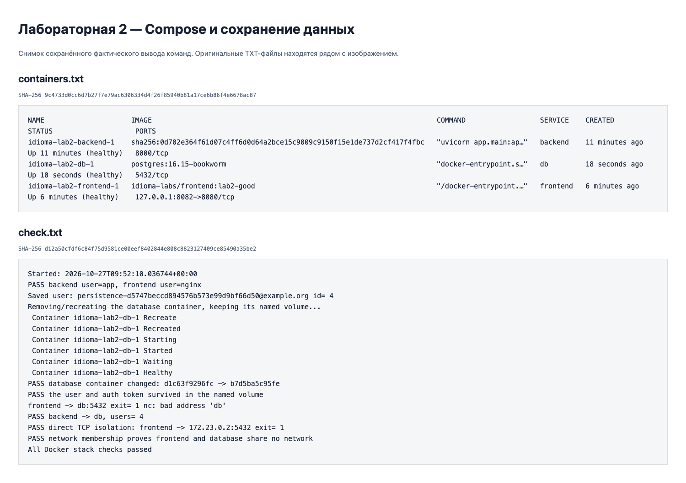
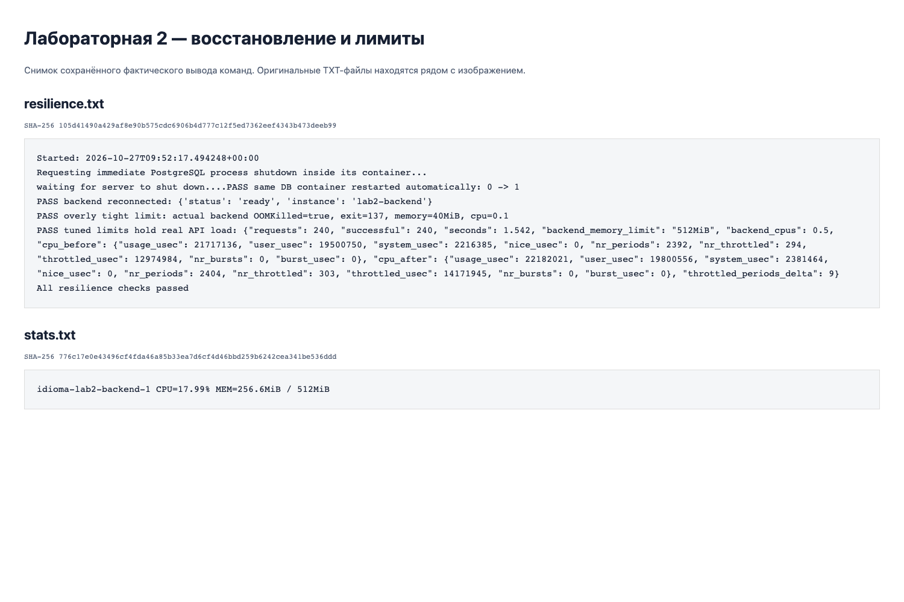

# Лабораторная 2 Docker

## Задача

Упаковать приложение idioma из лабораторной 0, сравнить неудачную и исправленную
сборки, запустить фронтенд, бэкенд и PostgreSQL одной командой и проверить сеть
и сохранение данных. Исходный код находится в `../lab0/app` и не дублируется.

## Плохой и хороший Dockerfile

| Практика | [Плохой](Dockerfile.bad) | [Хороший](Dockerfile.good) |
|---|---|---|
| База | Плавающий `python:3.12`, полный Debian | slim, точная версия Python и digest SHA-256 |
| Контекст | Весь репозиторий, включая исходники фронтенда | В runtime только приложение и готовые зависимости |
| Кеш | `COPY . .` перед установкой зависимостей | Сначала lock-файл, потом исходники; BuildKit cache mount |
| Стадии | Один этап | Отдельная установка зависимостей и runtime; отдельная сборка React |
| Пользователь | root по умолчанию | `app` у API, `nginx` у фронтенда |
| pip | Кеш попадает в образ | Кеш остаётся в builder, в runtime переносится venv |
| Запуск | Shell-форма CMD | Exec-форма CMD |
| Проверка здоровья | Отсутствует | HEALTHCHECK с запросом readiness, проверяющим PostgreSQL |

`requirements.lock` получен из реально запущенного и проверенного контейнера
лабы 0; `package-lock.json` зафиксирован в исходном проекте. Исключения контекста
находятся в корневом `.dockerignore` и `Dockerfile.good.dockerignore`.
Даже в плохой учебный образ не копируются реальные `.env`, ключи и Git-история.

## Запуск и обязательные проверки

```bash
docker compose up -d --build --wait
docker compose ps
docker compose exec -T backend whoami
python3 check.py 2>&1 | tee evidence/check.txt
```

Открыть [http://localhost:8082](http://localhost:8082).
Compose создаёт ровно три сервиса: `frontend`, `backend`, `db`.
Проверка регистрирует студента, пересоздаёт контейнер базы с другим ID и читает
того же пользователя с тем же токеном. Контейнер меняется, именованный том
`pgdata` остаётся. Данные переживают удаление контейнера, но не удаление тома.

Сети устроены так: `frontend — edge — backend — data — db`. База не публикует
порты на хост и находится в сети `internal`. Фронтенд подключён только к `edge`.
`check.py` запускает из фронтенда `nc -z -w 2 db 5432`, требует ошибку соединения,
дополнительно проверяет TCP-доступ по прямому IP базы (без зависимости от DNS),
а затем выполняет SQL из бэкенда. Также проверяется, что по `docker inspect`
у фронтенда и базы нет общей сети. nginx использует Docker DNS и обновляет
адрес бэкенда при его пересоздании.

## Измерение размера и пересборки

```bash
python3 benchmark.py | tee evidence/benchmark.txt
```

Скрипт копирует исходники во временный каталог, собирает оба образа,
добавляет одну строку комментария в `app/main.py` и измеряет повторные сборки
через `time.perf_counter()`. Основные исходники остаются неизменными.
Измерение включает время Docker CLI и экспорт образа. Начальные сборки не следует
считать одинаково холодными: часть базовых слоёв могла уже быть на машине.
Сравнение кеша делается по пересборке после одинаковой правки, а не по скачиванию базы.

Результаты и идентификаторы образов: [evidence/benchmark.json](evidence/benchmark.json).
Полные BuildKit-логи `initial-*.log` и `rebuild-*.log` позволяют увидеть,
где установка зависимостей выполнялась повторно, а где появилась отметка `CACHED`.

Измерено на Docker `aarch64`, 27.10.2026 12:47:46 МСК.

| Показатель | Плохой образ | Хороший образ |
|---|---:|---:|
| Размер по `docker image inspect .Size` | 1841.8 MiB | 407.3 MiB |
| Пересборка после изменения одной строки | 19.134 с | 0.552 с |
| Пользователь | root | app |

Размер уменьшился в 4.52 раза. У плохого образа
изменение кода заново запустило `pip install`; в хорошем зависимости остались
в кеше, переехал только слой исходников. В этом запуске пересборка ускорилась
примерно в 34.7 раза.


## Дополнительная часть Устойчивый стек

```bash
python3 resilience.py 2>&1 | tee evidence/resilience.txt
```

У сервисов заданы `restart: unless-stopped`, healthcheck, зависимости с
`condition: service_healthy`. Для API проверяется готовность базы через SQL,
а не только запущенный процесс. SQLAlchemy использует `pool_pre_ping`, чтобы
удалять оборванные соединения после перезапуска PostgreSQL.

Скрипт останавливает сам процесс PostgreSQL через `pg_ctl ... -m immediate`
внутри контейнера и требует увеличения `RestartCount` у того же контейнера.
Docker перезапускает контейнер, а API снова выполняет запросы. `docker stop`
для этой демонстрации не подходит: он намеренно отменяет автоматический рестарт.
Compose сам по себе не перезапускает контейнер только из-за статуса unhealthy;
здесь восстановление происходит именно после завершения основного процесса.

Для демонстрации OOM запускается отдельный временный контейнер того же API
с 40 MiB RAM и 0.1 CPU. Его состояние должно содержать `OOMKilled: true`
и код 137. Затем проверяется основной стек с лимитами:

| Сервис | RAM | CPU |
|---|---:|---:|
| backend | 512 MiB | 0.5 |
| frontend | 128 MiB | 0.5 |
| db | 256 MiB | 0.5 |

Под нагрузкой отправляются 240 настоящих запросов к каталогу из восьми потоков.
Проверяется отсутствие ошибок, сохраняются `docker stats` и изменение счётчика
`nr_throttled` из cgroup. Троттлинг показывает действие CPU-квоты; наличие
троттлинга само по себе не означает отказ сервиса. Измерения относятся к этой
машине и этому профилю нагрузки.

Плохой образ также проверен запуском того же API с PostgreSQL:
[bad-smoke.txt](evidence/bad-smoke.txt); воспроизведение — `python3 smoke-bad.py`
после `benchmark.py`. Временный контейнер скрипт удаляет сам.

Результаты: [check.txt](evidence/check.txt), [resilience.txt](evidence/resilience.txt),
[oom.json](evidence/oom.json), [load.json](evidence/load.json), [stats.txt](evidence/stats.txt).

Снимки сохранённых фактических протоколов; исходные TXT доступны рядом:





Регистрация и повторное чтение аккаунта проверены также через браузер:
[browser-check.txt](evidence/browser-check.txt), [после обновления](evidence/after-reload.png).


## Остановка и источники

```bash
docker compose down
```

Именованный том сохраняется. Для намеренного сброса данных — `docker compose down -v`.

Официальная документация: [Compose services](https://docs.docker.com/reference/compose-file/services/),
[порядок запуска](https://docs.docker.com/compose/how-tos/startup-order/),
[сети](https://docs.docker.com/compose/how-tos/networking/),
[кеш сборки](https://docs.docker.com/build/cache/optimize/).
Пример структуры отчёта: [Denisonya/CloudTech](https://github.com/Denisonya/CloudTech).
