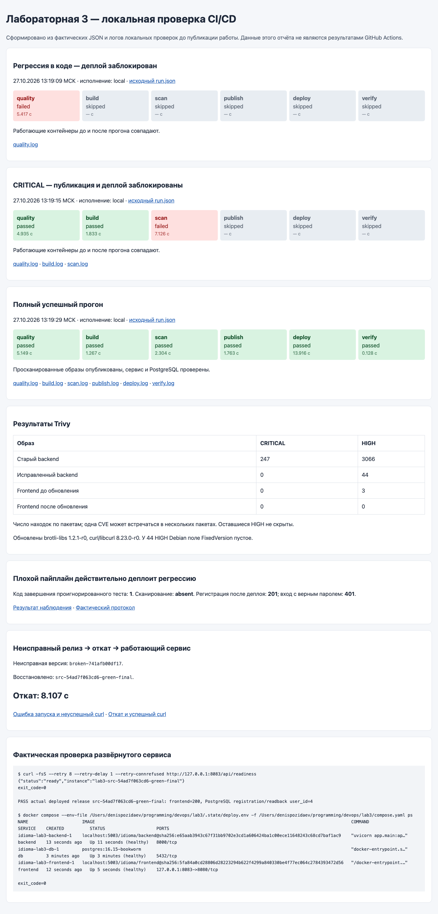
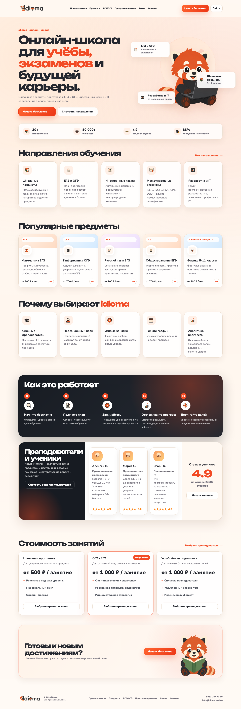

# Лабораторная 3 CI/CD

## Результат и границы проверки

Для idioma подготовлены плохой и хороший пайплайны и выполнены реальные локальные
прогоны: тесты → сборка → Trivy → публикация образов → деплой → проверка сервиса.
Также выполнена часть со звёздочкой: неисправный релиз и откат на рабочую версию.

В этом отчёте показаны **локальные прогоны**, выполненные до публикации работы,
а не прогоны GitHub Actions. Workflows включены в репозиторий; для выполнения
на GitHub нужен self-hosted runner с меткой `idioma-lab3` и настроенные secrets.
Во время локальной проверки Docker-образы публиковались только в собственный
реестр `localhost:5003`; это отдельная операция от публикации Git-коммита.

Сводка с реальными статусами и исходными протоколами: [evidence/index.html](evidence/index.html).



## Файлы и запуск

| Файл | Назначение |
|---|---|
| [ci.py](ci.py) | Один исполнитель стадий для локального запуска и GitHub Actions |
| [good workflow](../.github/workflows/lab3-good.yml) | Триггеры push/manual, шесть стадий, сохранение доказательств |
| [rollback workflow](../.github/workflows/lab3-rollback.yml) | Ручная джоба отката |
| [bad-pipeline.yml](bad-pipeline.yml), [bad_pipeline.py](bad_pipeline.py) | Намеренно плохой, но работающий пайплайн |
| [compose.yaml](compose.yaml) | Отдельный стенд `idioma-lab3`, сайт на порту 8083 |
| [registry.compose.yaml](registry.compose.yaml) | Локальный реестр образов на порту 5003 |
| [tests/test_auth_contract.py](tests/test_auth_contract.py) | Проверки регистрации, пароля и прав доступа |
| [Dockerfile.quality](Dockerfile.quality) | Среда lint/test с закреплёнными зависимостями |
| [Dockerfile.vulnerable](Dockerfile.vulnerable) | Устаревший образ того же приложения для security gate |
| [Dockerfile.broken](Dockerfile.broken) | Намеренно неисправный запуск для проверки rollback |

Требуются Python 3.9+, Docker с Compose, curl и доступ к Docker Hub/Alpine/базе
Trivy. Команды ниже выполняются **из корня репозитория**:

```bash
python3 lab3/ci.py run
```

После успешного выполнения открыть [http://localhost:8083](http://localhost:8083).
Каждый запуск получает отдельную папку в `lab3/evidence`. Повторные запуски создают
новые идентификаторы и сохраняют прежние протоколы.

```bash
# Ожидаемо завершается кодом 1 на тестах. Образы и деплой не меняются.
python3 lab3/ci.py run --scenario broken-code

# Ожидаемо завершается кодом 1 на Trivy. Push и деплой заблокированы.
python3 lab3/ci.py run --scenario vulnerable

# Плохой пайплайн: отдельный стенд localhost:8084, только учебные данные.
python3 lab3/bad_pipeline.py
```

## Плохой и хороший пайплайн

| Практика | Плохой вариант | Хороший вариант |
|---|---|---|
| Тесты | Реальный упавший тест игнорируется, деплой продолжается | Любая ошибка останавливает следующие стадии |
| Сканирование | Отсутствует | Trivy действительно возвращает код 1 при CRITICAL |
| Кеш | `--no-cache`, зависимости скачиваются заново | Кеш слоёв и BuildKit cache mounts для pip/npm |
| Версии | Только перезаписываемый `latest`, action `@main` | Теги по хешу исходников/прогону, деплой по digest, actions по SHA |
| Пароли | Публичные фиктивные значения в YAML | Случайные локальные пароли или GitHub Actions Secrets |
| Права workflow | `permissions: write-all` | `contents: read`, `packages: write` для публикации в GHCR |
| Проверка релиза | Нет блокирующей проверки после деплоя | Compose healthcheck, curl, регистрация и чтение из PostgreSQL |
| Откат | Нет учёта предыдущей рабочей версии | Сохранённый манифест с неизменяемыми digest |

Плохой вариант действительно запускался: [result.json](evidence/bad-pipeline/result.json)
и [pipeline.log](evidence/bad-pipeline/pipeline.log). Он игнорирует упавший тест,
собирает и публикует именно код с регрессией. Наблюдатель после деплоя фиксирует:
сервис отвечает, регистрация возвращает 201, но вход с верным паролем даёт 401.
Это показывает, почему одной успешной сборки недостаточно.

Плохой workflow лежит вне `.github/workflows`, поэтому автоматически не запускается.
Его фиксированные пароли — открытые учебные значения отдельного стенда.

## Проверка кода и блокировка регрессии

Ruff проверяет синтаксис и критические ошибки Python. Затем запускаются 10
исходных тестов проекта и 5 новых тестов HTTP-контракта авторизации. Новые тесты
проверяют, что пароль не хранится и не возвращается открытым текстом, сохранённый
аккаунт читается и допускает повторный вход, неверный пароль и повторная
регистрация отклоняются, а публично создать администратора нельзя.

Для отрицательного прогона во временной копии `hash_password()` заменён возвратом
исходного пароля. Проверяются настоящие последствия ошибки через API и базу,
а не специально написанный `assert False`. Основные исходники при этом не меняются.

Протокол: [red-code-final/run.json](evidence/red-code-final/run.json),
[quality.log](evidence/red-code-final/quality.log),
[регрессия](evidence/red-code-final/regression.diff).
Стадии build/scan/publish/deploy/verify имеют статус `skipped`.
Идентификаторы уже работающих контейнеров до и после отклонённого прогона совпали.

SQLite используется только внутри изолированных unit-тестов. Настоящий деплой
использует отдельный PostgreSQL; запись и чтение из него проверяются после запуска.

## Security gate и исправление уязвимостей

Используется Trivy 0.76.1, образ закреплён по digest. Сначала создаётся полный JSON
для HIGH и CRITICAL, затем тот же архив проверяется командой
`trivy image --input ... --severity CRITICAL --exit-code 1`.
Ошибки загрузки базы/сканера также останавливают пайплайн. Исключений CVE и
`--ignore-unfixed` нет. Сканер получает tar-архив образа в режиме чтения;
доступ к Docker-сокету ему не предоставляется.

| Образ | CRITICAL | HIGH | Результат |
|---|---:|---:|---|
| Бэкенд на старом полном `python:3.12.0-bookworm` | 247 | 3066 | Trivy exit 1, push/deploy skipped |
| Бэкенд из исправленного Dockerfile лабы 2, `python:3.12.16-slim` | 0 | 44 | CRITICAL gate пройден |
| Фронтенд до обновления пакетов Alpine | 0 | 3 | Найдены доступные исправления HIGH |
| Фронтенд после обновления пакетов | 0 | 0 | Скан пройден |

Это число **находок по установленным пакетам**, не число уникальных идентификаторов
CVE: одна CVE может относиться сразу к нескольким пакетам.

Переход на актуальный slim убрал старые пакеты полного Debian и их CRITICAL.
В runtime фронтенда [Dockerfile.good](../lab2/Dockerfile.good) обновлены с фиксацией
версий `brotli-libs` до `1.2.1-r0`, `curl` и `libcurl` до `8.23.0-r0`.
Тем самым закрыты найденные `CVE-2026-111497` и `CVE-2026-92392`.
У оставшихся 44 HIGH бэкенда поле `FixedVersion` в отчёте Trivy пустое;
готовое исправление для используемых пакетов Debian сканер не указал.
Эти находки сохранены в отчёте и не подавляются. Зелёный CRITICAL gate не означает
полного отсутствия уязвимостей.

Исходные результаты: [старый бэкенд](evidence/red-security-final/backend-trivy.json),
[новый бэкенд](evidence/green-final/backend-trivy.json),
[фронтенд до](evidence/frontend-before.json),
[фронтенд после](evidence/green-final/frontend-trivy.json).
Проверка блокировки: [scan.log](evidence/red-security-final/scan.log).

## Успешный путь до работающего сервиса

[green-final/run.json](evidence/green-final/run.json) содержит шесть реально
пройденных стадий. Сборка выполняется из Dockerfile лабы 2, после скана публикуются
те же образы, а перед публикацией повторно сверяется их ID. Реестр возвращает
digest, который записывается в [release.json](evidence/green-final/release.json).
Compose получает ссылку `repository@sha256:...`, а не плавающий `latest`.

В последней стадии выполняется настоящий curl readiness, проверяется ожидаемый
идентификатор релиза, HTML React и запись/чтение пользователя в PostgreSQL:
[verify.log](evidence/green-final/verify.log).

Секреты генерируются в закрытом `lab3/.state/deploy.env` с правами 600; каталог
исключён из Git и Docker build context. Они не входят в артефакты отчёта.
Для локальных непубликуемых изменений версия включает хеш исходников, а в
`base_git_head` отдельно хранится исходный Git HEAD — эти значения не выдаются
за новый Git-коммит. В [git-state.json](evidence/git-state.json) сохранено состояние
до публикации лабораторной: на этапе локальных проверок новых коммитов не было.

## Часть со звёздочкой Откат

```bash
# Создать намеренно неисправный релиз и сразу восстановить рабочий.
python3 lab3/ci.py demo-rollback

# Отдельная ручная команда возврата на предыдущую рабочую версию.
python3 lab3/ci.py rollback
```

Релиз с изменённым CMD завершается при запуске. Compose фиксирует ошибку готовности,
запрос к API перестаёт быть успешным. Предыдущий рабочий манифест заранее сохранён
в `.state/previous.json`; откат использует его backend/frontend digest, дожидается
healthcheck и повторяет curl и проверку БД. Том PostgreSQL при этом сохраняется.
Демонстрация восстанавливает стенд в блоке `finally` и при собственной ошибке.

В окончательном прогоне возврат на рабочую версию занял **8.107 с**.

Доказательства: [неисправный релиз](evidence/broken-release-20261027T102551Z/broken-release.log),
[откат и успешный curl](evidence/rollback-20261027T102558Z/rollback.log),
[метрика](evidence/rollback-20261027T102558Z/rollback.json).



## Запуск GitHub Actions

Workflows включены в репозиторий. Приведённые выше результаты получены локально.
Для выполнения на GitHub нужен self-hosted runner с меткой `idioma-lab3`, Python,
Docker/Compose и curl. Он выполняет те же команды `ci.py stage`, что проверены
локально. В workflow нет триггера на сторонние pull request.

В настройках репозитория потребуются secrets `LAB3_POSTGRES_PASSWORD` и
`LAB3_ADMIN_PASSWORD`: URL-safe значения длиной 16–128 символов. При использовании
уже существующей локальной БД пароль должен совпадать с её паролем из закрытого
`deploy.env`. Перед переносом существующего стенда следует сохранить и перенести
его `current.json`, `previous.json`, `deploy.env` в `LAB3_STATE_DIR` runner-а.

По умолчанию workflow публикует в локальный реестр runner-а. Для GHCR можно задать
переменную `LAB3_REGISTRY=ghcr.io/ig1rkas/dev-ops-labs`; авторизация использует
`secrets.GITHUB_TOKEN` через `--password-stdin`. Actions закреплены по полным SHA,
Trivy и базовые образы — по digest. Кеш слоёв, pip/npm и базы Trivy сохраняется
на постоянном Docker-хосте self-hosted runner-а между прогонами.
Concurrency group сериализует деплои и откаты, а история релизов хранится вне
очищаемого checkout. Публикация в `main` запускает workflow по push-триггеру;
при отсутствии подходящего runner задание остаётся в очереди. Результаты
выполнения на GitHub следует смотреть во вкладке Actions; локальные результаты
в этом отчёте не подменяются скриншотами GitHub.

## Остановка и источники

```bash
python3 lab3/stop.py
docker compose -f lab3/bad.compose.yaml down
docker compose -f lab3/registry.compose.yaml stop
```

`stop.py` сам читает сохранённый манифест и закрытый файл окружения. Том с данными
сохраняется. Другие лабораторные имеют собственные проекты Compose.

Из [истории про Васю](https://habr.com/ru/articles/689234/) здесь применён принцип
воспроизводимого описания инфраструктуры: команды, порядок стадий и схема отката
сохранены в файлах; ручные действия не являются единственным способом восстановить
окружение. Это вывод из истории, а не основание добавлять лишние сервисы в стенд.

Документация: [Trivy image и tar-архивы](https://trivy.dev/docs/latest/guide/target/container_image/),
[коды завершения Trivy](https://trivy.dev/docs/latest/guide/configuration/others/),
[GitHub Packages и GITHUB_TOKEN](https://docs.github.com/en/packages/managing-github-packages-using-github-actions-workflows/publishing-and-installing-a-package-with-github-actions),
[добавление self-hosted runner](https://docs.github.com/en/actions/how-tos/manage-runners/self-hosted-runners/add-runners).
